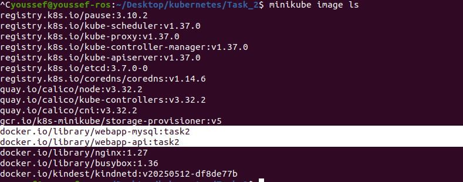
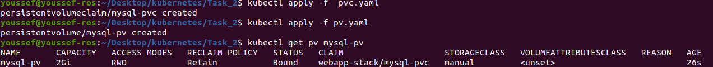
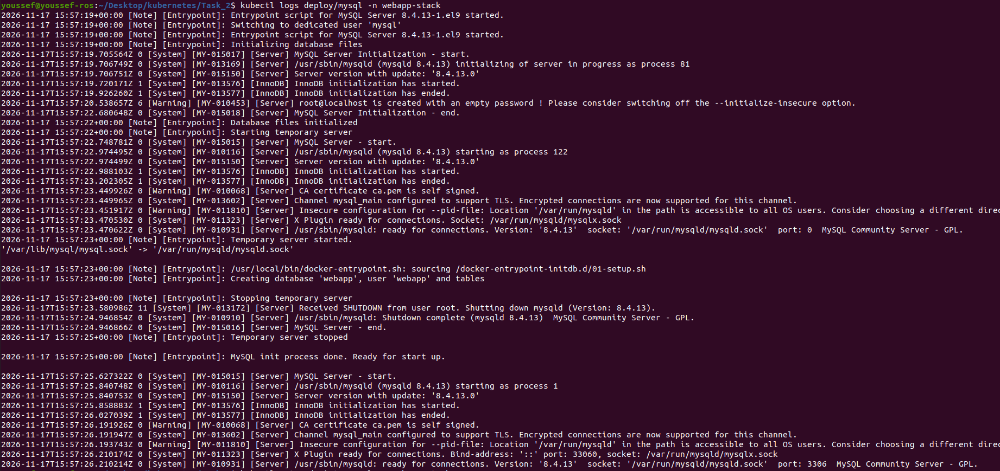
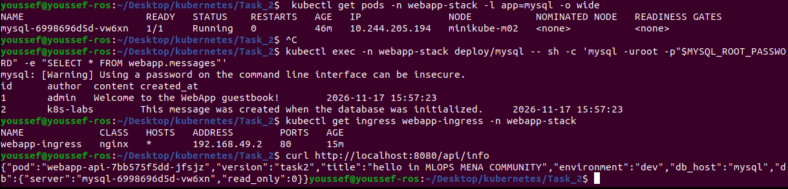
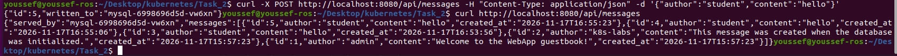
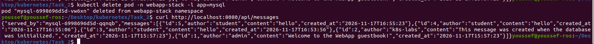

# Task_2
## 1) uploading 2 images (webapp-mysql:task2 and webapp-api:task2):

## 2) checking on configMap and secret after creation:

## 3) pv and pvc creation (connecting pvc to pv through storageclassName,accessMode,volumeName,storage): 

## 4) logs of mysql pod ( "ready for connections" ) and endpoint of its service:

## 5) env vars of webapp-api pod:
-of-webapp.png)

## 6) after createing 2 webapp-api pods (3 pods running):

## 7) some checks ( pod mysql on which node => minikube-m02 (because pv is located there)) and some requests:

## 8) Write a message (return response with id and pod name):

## 9) Read messages:

## 10) Data survives a restart (because the new mysql pod has the same volumes and volumeMounts config, so it mounts mysql-pvc at /var/lib/mysql and finds the existing data):

