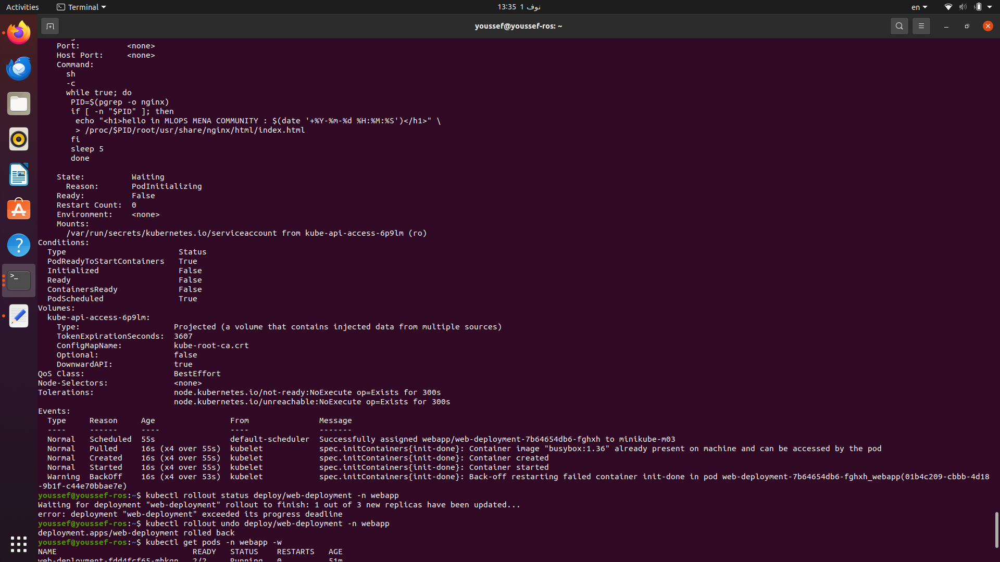
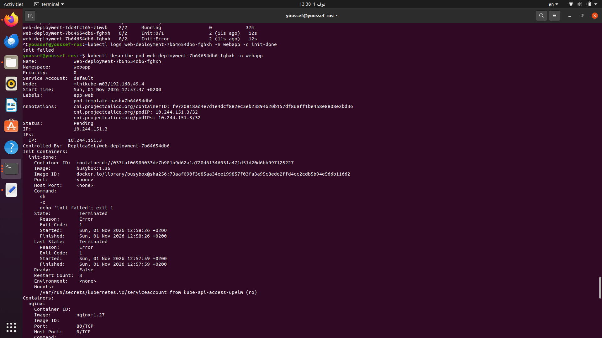

# Task_1
## Creating 3 nodes first by writing:
    `minikube start --nodes 3 --cni=calico --cpus 2 --memory 2200`
## watching nodes:
    `kubectl get nodes` 
     output:
     NAME           STATUS   ROLES           AGE   VERSION
     minikube       Ready    control-plane   97m   v1.37.0
     minikube-m02   Ready    <none>          97m   v1.37.0
     minikube-m03   Ready    <none>          97m   v1.37.0

## Creating namespcae by appling file namespace.yaml:
    `kubectl apply -f namespace.yaml`
    output:  namespace/webapp created
    
## Creating cluster containing 3 pods/replicas by appling file deployment.yaml (each pod with 3 containers):
    `kubectl apply -f deployment.yaml`
    output: deployment.apps/web-deployment created

## watching pods creation until be running:
    `kubectl get pods -n webapp -w `
    output: 
    NAME                             READY   STATUS            RESTARTS   AGE
    web-deployment-fdd4fcf65-mhkqn   0/2     PodInitializing   0          18s
    web-deployment-fdd4fcf65-ph9mf   0/2     PodInitializing   0          18s
    web-deployment-fdd4fcf65-zlmvb   0/2     PodInitializing   0          18s
    web-deployment-fdd4fcf65-mhkqn   2/2     Running           0          74s  
    web-deployment-fdd4fcf65-zlmvb   2/2     Running           0          86s
    web-deployment-fdd4fcf65-ph9mf   2/2     Running           0          88s

## connecting a pod with port 80 to localhost with port 8080:
	`kubectl port-forward -n webapp deploy/web-deployment 8080:80 `
	output:
	Forwarding from 127.0.0.1:8080 -> 80
	Forwarding from [::1]:8080 -> 80
	
    so whenever entering `http://localhost:8080/` you be able to see html file with msg:
    	hello in MLOPS MENA COMMUNITY : 2026-11-01 11:28:05  -> updateing every 5s.
## inserting this command: ["sh", "-c", "echo 'init failed'; exit 1"] and appling deployment.yaml:
	`kubectl get pods -n webapp -w`
	output: 
	NAME                              READY   STATUS                  RESTARTS     AGE
	web-deployment-7b64654db6-fghxh   0/2     Init:CrashLoopBackOff   1 (3s ago)   4s
	web-deployment-fdd4fcf65-mhkqn    2/2     Running                 0            37m
	web-deployment-fdd4fcf65-ph9mf    2/2     Running                 0            37m
	web-deployment-fdd4fcf65-zlmvb    2/2     Running                 0            37m
	web-deployment-7b64654db6-fghxh   0/2     Init:0/1                2 (11s ago)   12s
	web-deployment-7b64654db6-fghxh   0/2     Init:Error              2 (11s ago)   12s
	`kubectl logs web-deployment-7b64654db6-fghxh -n webapp -c init-done`
	output: init failed
	`kubectl describe pod web-deployment-7b64654db6-fghxh -n webapp`
	The describe was too big so I will put the image.
	
	

## watching creating new pods (but they can't be up because error in init-done):
	`kubectl rollout status deploy/web-deployment -n webapp`
	output:
	Waiting for deployment "web-deployment" rollout to finish: 1 out of 3 new replicas 		have been updated...
	error: deployment "web-deployment" exceeded its progress deadline
	
After exceeding 10 minutes(and a lot of restarts for init-done container forever) the rollout status stops waiting and the previous pods weren't deleted because the new ones never go up because the error.
##  Which status does the new Pod show? Do nginx and time-updater start? Is the page still reachable, and why?

Answer: 1) Init:CrashLoopBackOff, cycling through Init:0/1, Init:Error, then Init:CrashLoopBackOff, with the RESTARTS counter going up(bigger waiting to retry after).
2) no
3) yes
4)the previous pods weren't deleted because the new ones never go up because the error in container init-done no pod goes up and after exceeding time the rollout status stops waiting.

## then getting back with version that alread works(fix it):
	`kubectl rollout undo deploy/web-deployment -n webapp`
	output: deployment.apps/web-deployment rolled back
the previous pods never stop runing but I rolled to working version so kubelet does not retry forever to init new pods so undo to  make controller in master node remove broken pods.
	`kubectl get pods -n webapp`
	output: 
	NAME                             READY   STATUS    RESTARTS   AGE
	web-deployment-fdd4fcf65-mhkqn   2/2     Running   0          51m
	web-deployment-fdd4fcf65-ph9mf   2/2     Running   0          51m
	web-deployment-fdd4fcf65-zlmvb   2/2     Running   0          51m

	

    	

